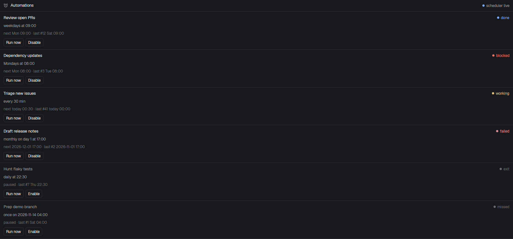

# herdr-automations

Local scheduled agent automations for the [Herdr](https://herdr.dev) desktop app, in two parts:

1. **Scheduler** (`plugins/automations`, Bun): fires tasks from `~/.config/automations/tasks.json` on cron or once schedules. Each run opens a new app space (`<title> run <n>`) with the agent in the task's folder and the prompt as its first message.
2. **Mod** (`mods/automations`): a Herdr side panel listing the tasks, their next and last runs, with Run now, Enable/Disable, Show run and Start.



The Herdr app must be open for runs to fire (each run is a `herdr-app do space.new`). Missed runs are skipped, not replayed. Webhook triggers are planned.

## Install

Requires [Bun](https://bun.sh) and the Herdr desktop app (`herdr-app`, `herdr-core`/`hc`).

```sh
git clone <this repo> && cd herdr-automations
bun install
plugins/automations/bin/start   # idempotent; opens the "Automations" space, writes ~/.config/automations/cli.json
cp -r mods/automations ~/.config/herdr-app/mods/
herdr-app check ~/.config/herdr-app/mods/automations
```

`bin/stop` closes the scheduler. For mod development, symlink instead of copying: `ln -sfn "$PWD/mods/automations" ~/.config/herdr-app/mods/automations`.

Optional skill for agents (`/schedule-local`):
```sh
ln -sfn "$PWD/skills/schedule-local" "$CLAUDE_CONFIG_DIR/skills/schedule-local"
```

### What the mod does on your machine

The mod **runs programs** with `exec`: `bun` (the automations CLI), which in turn runs `herdr-app` and `hc`. It **reads `~/.config/automations/cli.json`** (outside its own folder) and, through the CLI, `~/.config/automations/tasks.json` and `~/.local/state/automations/`. It changes `tasks.json` only when you press Enable/Disable. It does not use the network.

## Use

- Tasks: `~/.config/automations/tasks.json` (format in `skills/schedule-local/SKILL.md`), re-read every 5s.
- Runs: `~/.local/state/automations/runs.json`.
- CLI: `bun plugins/automations/src/cli.ts list [--json] | run-now <id> [--bg] | enable <id> | disable <id> | status [--json] | start | stop`
- `AUTOMATIONS_HC` / `AUTOMATIONS_APP` override the `herdr-core` / `herdr-app` binaries.

## Dev

`bun test`, `bun run typecheck`. Design notes: `docs/design.md`. Mod brief: `mods/automations/RECIPE.md`.

## License

MIT
