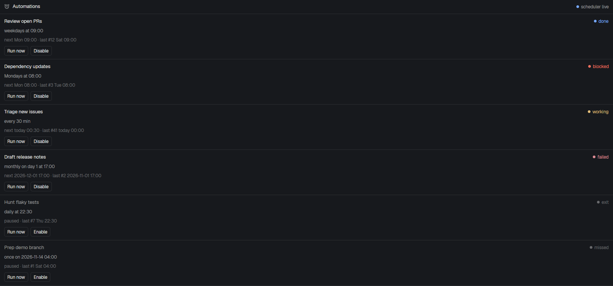

# herdr-triggers

**Cron, one-off and webhook triggers for any coding agent in the [Herdr](https://herdr.dev) desktop app.**

A Grafana alert, a ClickUp task or a cron line opens a new app space with Claude Code, Codex, Pi or OpenCode in your repo, with the prompt (and the webhook body) as its first message. One Go binary, a JSON task file, a TUI to edit it and a side panel in the app.



- **Triggers**: 5-field cron (local time, `L`/`W`/`#` supported), once at a date, or a webhook (`POST /hooks/<id>` with a per-task token).
- **Any agent**: `claude`, `codex`, `pi`, `opencode` know their model flag and prompt argument; any other binary gets `--model <m>` and the prompt last. Per task `model`, `agentArgs`, `timeoutMinutes`.
- **Survives sleep**: a run due while the machine slept fires on wake within `catchUpMinutes` (default 120); older ones are recorded `missed`.
- **Never overlaps itself**: a fire or webhook is refused while the task's previous run is still working or blocked.
- **Tells you when it matters**: `failed`, `blocked`, `error`, `timeout` and `missed` raise a desktop notification.
- **Webhook payloads are untrusted**: the body reaches the agent framed between random-tagged markers, labelled as data, not instructions. Bodies over 64 KB are refused. Every delivery is logged.

The Herdr app must be open for runs to start (each run is a `herdr-app do space.new`).

## Install

Requires Go 1.26+ and the Herdr desktop app (`herdr-app`, `herdr-core`/`hc`).

```sh
git clone https://github.com/tiagokriok/herdr-triggers && cd herdr-triggers
go build -o ~/.local/bin/herdr-triggers ./cmd/herdr-triggers
herdr-triggers start                       # opens the "Triggers" space running the scheduler
cp -r mods/triggers ~/.config/herdr-app/mods/
herdr-app check ~/.config/herdr-app/mods/triggers
```

`start` is idempotent and writes `~/.config/herdr-triggers/cli.json`, which the panel reads to find the binary. `stop` closes the scheduler. For mod development, symlink instead of copying.

Optional skill for agents (`/schedule-local`): `ln -sfn "$PWD/skills/schedule-local" ~/.claude/skills/schedule-local`.

## Use

```sh
herdr-triggers tui              # browse, add, edit, enable/disable, run now, delete
herdr-triggers list [--json]
herdr-triggers run-now <id> [--bg]
herdr-triggers enable <id> | disable <id>
herdr-triggers status [--json] | start | stop
herdr-triggers token            # a random webhook token
```

- Tasks: `~/.config/herdr-triggers/tasks.json` (format in `skills/schedule-local/SKILL.md`), re-read every 5 s. Edit it by hand, with the TUI, or let an agent use the skill.
- State: `~/.local/state/herdr-triggers/state.db` (SQLite: runs and webhook deliveries).
- Env: `TRIGGERS_ADDR` (default `127.0.0.1:8787`), `TRIGGERS_HC`, `TRIGGERS_APP`, `CLAUDE_CONFIG_DIR` (forwarded to claude runs).

### Webhooks

```json
{ "id": "grafana-alert", "title": "Investigate alert", "prompt": "Find the cause of this alert and propose a fix.",
  "cwd": "/abs/path/to/repo", "schedule": { "type": "webhook", "token": "<herdr-triggers token>" },
  "enabled": true, "agent": "claude" }
```

```sh
curl -X POST http://127.0.0.1:8787/hooks/grafana-alert -H "Authorization: Bearer <token>" -d '{"alert":"cpu"}'
```

The token may also go in `X-Triggers-Token` or `?token=` (for senders that only take a URL). Replies: `202 {"task","run"}`, `401` bad token, `404` no enabled webhook task, `409` previous run still active, `413` body over 64 KB.

The server listens on localhost only. To receive webhooks from outside, put it behind [Tailscale Funnel](https://tailscale.com/kb/1223/funnel) (`tailscale funnel 8787`) or another tunnel, and use the public URL in Grafana, ClickUp, GitHub, etc.

### What this does on your machine

- The scheduler runs in a Herdr app space and runs `herdr-app`, `hc`, each task's agent, and `notify-send` (`osascript` on macOS) for alerts.
- It writes `~/.config/herdr-triggers/` (only when you or the TUI change tasks, and `cli.json` on `start`) and `~/.local/state/herdr-triggers/`.
- It opens one HTTP port, on `127.0.0.1` only.
- The **mod runs programs** with `exec`: the `herdr-triggers` binary named in `~/.config/herdr-triggers/cli.json`, which it reads from outside its own folder. It changes `tasks.json` only when you press Enable/Disable. It does not use the network.

## Similar projects

- [DnzzL/herdr-automations](https://github.com/DnzzL/herdr-automations): a mature cron scheduler for Herdr, TUI and app, with a git worktree per run and YAML config. Choose it for worktree-isolated runs on a clock; choose this one for webhook triggers, one-off runs and per-agent argv. Some ideas here (catch-up window, failure alerts, per-task model) were inspired by it.
- [T3 Code](https://github.com/pingdotgg/t3code) scheduled tasks inspired the SQLite run/delivery log and the framing of untrusted webhook payloads.

## Dev

`go test -race ./...`, `go vet ./...`. Design notes: `docs/design.md`. Mod brief: `mods/triggers/RECIPE.md`.

## License

MIT
