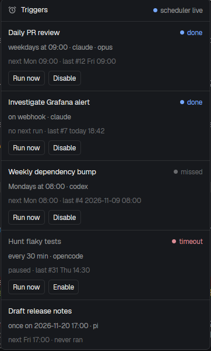

# Triggers

A side panel listing the local agent triggers of this machine (cron, once and webhook tasks run by herdr-triggers): each task's title, when it runs, when it runs next and how its last run went, with buttons to run it now, pause or resume it, and jump to the space of its last run. A header shows whether the scheduler is running and starts it when it isn't.

## What you see

Top to bottom, in a 320px column docked right (`mod.json`: `place: "right"`, `size: 320`; opened with `mod.open`, a 360×600 floating panel: `overlay: {width: 360, height: 600}`), background `theme().surface`, text 12.5px `theme().foreground`:

1. **Header**, 38px, bottom border `theme().border`: a 14px alarm-clock icon (`icon.svg`, tinted `muted`), "Triggers" in semibold, then on the right a 7px dot and "scheduler live" (dot `done`) or "scheduler stopped" (dot `dim`), in 11.5px `muted`. While stopped, a "Start" button follows.
2. **Update line** (only when `list --json` has `update`): 11.5px `muted`, bottom border, "<latest> available: <command>".
3. **Problem line** (only when there are tasks and something failed): 11.5px in `blocked`, e.g. a `tasks.json` validation error.
4. **Task rows**, scrolling (`overflow_y_scrollbar`), each 12px side padding, 9px vertical, bottom border:
   - Line 1: title (semibold, `foreground`; `muted` when paused, truncated) and, right-aligned, the last run status as a 7px dot plus the word, both in the status color.
   - Line 2: 11.5px `muted`: the trigger in words ("weekdays at 09:00", "Mondays at 08:00", "every 30 min", "hourly at :15", "monthly on day 1 at 17:00", "once on 2026-11-14 04:00", "on webhook", else "cron <expr>"), then " · <agent>" or " · <agent> · <model>".
   - Line 3: 11.5px `dim`: "next <when>" or "paused" or "no next run", then " · last #<n> <when>" or " · never ran". `<when>` is "today HH:MM", "Ddd HH:MM" within 6 days, else "YYYY-MM-DD HH:MM", local time.
   - Line 4: buttons, 11.5px, 1px `border` outline, 5px radius, hover `hover`: "Run now", "Disable"/"Enable", and "Show run" only while the last run's space is still open.
5. **Empty state**, 12px `muted` text: with no `cli.json`, setup steps (install the `herdr-triggers` binary, run `herdr-triggers mod install`); with no tasks, a pointer to `herdr-triggers tui` and the `schedule-local` skill; when the CLI can't run, "Can't run herdr-triggers: <error>".

## How it behaves

- Status colors: working and starting `theme().working`, blocked `blocked`, done `done`, failed, error and timeout `ansi1`, missed `unknown`, anything else (exit) `idle`. Agent status here is the run's recorded status, not live `agents()` data.
- Every 10 s (`cx.timer.every(10000)`) and after every action it re-reads the list and the scheduler status.
- Run now: runs the task at once in the background; the button reads "Starting…" until the CLI returns.
- Disable/Enable: flips the task's `enabled` in `tasks.json`; a paused row greys its title and says "paused".
- Show run: `space.select {id}` on the last run's space.
- Start: starts the scheduler (opens its "Triggers" space), then refreshes.
- Errors from any action show in the problem line; nothing else moves or animates.

## Built from

- `mods/triggers/main.js` (one `View`), `mod.json`, `icon.svg` (24px Lucide-style alarm clock, stroke `currentColor`).
- `herdr`: `exec`, `home`, `readTextFile`, `run("space.select")`, `spaces()` (to know if the last run's space is open), `theme()`. `gpui-kit`: `View`, `div`, `svg`; `gpui-base`: `h_flex`, `v_flex`.
- It reads `~/.config/herdr-triggers/cli.json` (`{ "argv": ["<path>/herdr-triggers"] }`, written by `herdr-triggers start`) and runs that argv plus:
  - `list --json` → `{ tasks: [{ id, title, schedule, enabled, agent, model, next, last: { n, status, firedAt, space, terminal } | null }], error?, update: { latest, command } | null }`
  - `status --json` → `{ state: "live", space, terminal } | { state: "stopped" }`
  - `run-now <id> --bg`, `enable <id>`, `disable <id>`, `start`.
- Programs it runs: the `herdr-triggers` binary, which itself runs `herdr-app`, `hc`, the agents and `notify-send`.

## Watch out

- No `setTimeout`: poll with `cx.timer.every`, run work in `cx.spawn`, never keep a `cx`.
- `exec` times out at 30 s by default; `run-now` must use `--bg` (the CLI detaches) or the panel waits for the whole agent run. The panel passes `timeout: 20000`.
- The mod can't see the user's env, so it can't find the binary or honor `XDG_CONFIG_HOME`: `cli.json` is fixed at `~/.config/herdr-triggers/cli.json`. Its argv may start with `env K=V` to point the CLI at other dirs (used for the preview).
- The app writes `jsconfig.json` and `gpui-kit.d.ts` into the mod folder; don't commit them.
- Paused tasks have no next run; a once-task that already fired shows "paused".
- Runs only fire while the Herdr app is open (each run is a `herdr-app do space.new`).

## Done when

- `herdr-app check ~/.config/herdr-app/mods/triggers` passes.
- With no `cli.json`, the panel shows the setup steps instead of failing.
- With tasks, each row shows title, schedule words, next/last line and a colored last status; the header says "scheduler live" while `herdr-triggers status` says live.
- "Disable" turns into "Enable" within one refresh and `tasks.json` shows `"enabled": false`.
- "Run now" opens a new space named "<title> run <n>" and the row's status becomes working.
- "Show run" switches to that space; it disappears once the space is closed.
